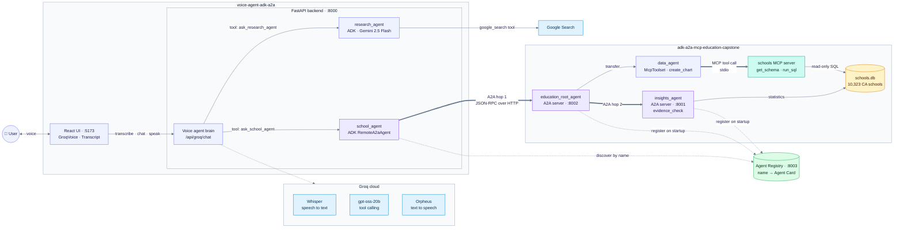
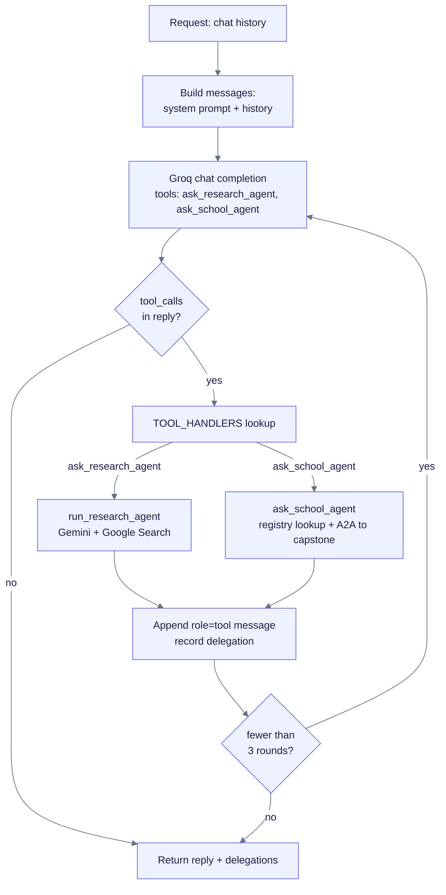
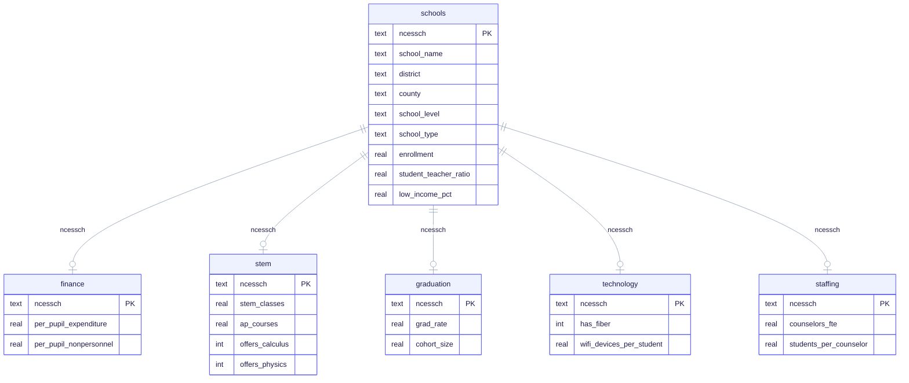
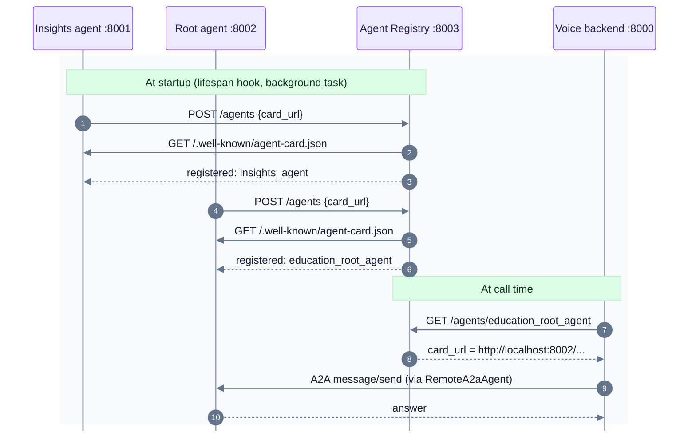
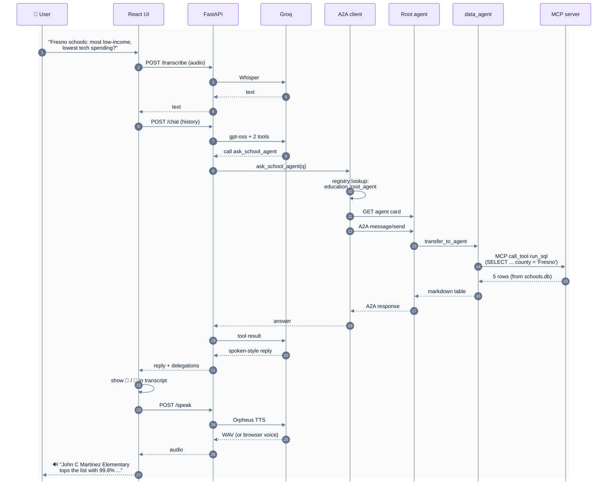

# High-Level Design: Voice Agent + Education Insights Capstone

A voice assistant that answers general questions with **Google Search** and California school
questions with a **multi-agent education analytics system**. It is built from two independent
projects that talk to each other over the **A2A (Agent-to-Agent) protocol**, find each other
through an **Agent Registry**, and reach the school database through an **MCP (Model Context
Protocol) server**.

| Project | Folder | Role |
|---|---|---|
| **Voice Agent** | `voice-agent-adk-a2a/` | Voice front end: listens, decides what to do, delegates, speaks |
| **Education Insights & Resource Recommender** (capstone) | `adk-a2a-mcp-education-capstone/` | School-data agents: SQL analytics, charts, evidence-based recommendations |

---

## 1. Goals

1. **Voice in, voice out.** Ask questions naturally by voice and hear spoken answers.
2. **Delegation.** The voice agent doesn't answer facts itself. It hands each question to the
   specialist agent best placed to answer it.
3. **Reuse through open protocols.** The capstone runs as its own service and is reached over A2A,
   not imported as a library, so either side can change, scale or be replaced independently.
4. **Grounded answers.** General facts come from live Google Search; school facts come from
   real federal datasets (NCES, CRDC, EdFacts), not from the model's memory.
5. **Discovery, not hard-coding.** Agents register themselves in an Agent Registry, and callers
   look them up by name, so an agent can move to a new host or port without changing its callers.
6. **Standard tool access.** The database tools are served by an MCP server, so the same tools
   work for the ADK data agent and for any other MCP client (Claude Desktop, IDEs, MCP Inspector).

---

## 2. System Architecture



Purple boxes are the agents on either side of an A2A call; bold arrows are A2A network calls
and the MCP tool call; blue boxes are external cloud services; the teal box is the MCP server;
the green box is the Agent Registry, and its dotted arrows are registration (at startup) and
discovery (at call time). Not shown, to keep the picture readable: the optional
OpenAI Realtime mode (`RealtimeVoice.jsx` → `/api/session` → WebRTC), the capstone's other
front ends (Streamlit on :8501 and `adk web`), and the data loader (`data/build_db.py` ← Urban
Institute API). Each is covered in sections 3 and 4.

**Two levels of A2A, plus MCP.** The voice agent calls the capstone over A2A (port 8002), and
inside the capstone the root agent calls the insights agent over A2A (port 8001). The data agent
reaches the database through MCP tools. A2A connects **agents to agents**; MCP connects **agents
to tools**.

---

## 3. Project 1: Voice Agent (`voice-agent-adk-a2a/`)

### 3.1 Frontend (React 19 + Vite 6)

| Component | Responsibility |
|---|---|
| `App.jsx` | Shell and mode toggle (**Groq** default, **OpenAI Realtime** optional) |
| `GroqVoice.jsx` | Turn-based voice loop: records mic audio with `MediaRecorder` (WebM/Opus), posts it for transcription, sends chat history to the backend, plays the reply |
| `RealtimeVoice.jsx` | Streaming speech-to-speech over **WebRTC** to OpenAI Realtime. Registers the same two tools on the data channel (`oai-events`) and routes tool calls to the backend |
| `Transcript.jsx` | Shows user / agent / delegation / error messages, so every hand-off is visible on screen |
| `AgentRegistry.jsx` | Collapsible "🗂️ Agent Registry" panel: every registered agent with name, endpoint, description and a live up/down dot |
| `vite.config.js` | Dev proxy `/api → :8000`: same origin, no CORS setup |

### 3.2 Backend (FastAPI 0.162 + Uvicorn)

| Endpoint | What it does | External call |
|---|---|---|
| `POST /api/groq/transcribe` | Speech → text | Groq `whisper-large-v3-turbo` |
| `POST /api/groq/chat` | One voice-agent turn with tool calling (loops up to 3 tool rounds) | Groq `openai/gpt-oss-20b` |
| `POST /api/groq/speak` | Text → speech (WAV). Returns `503` if unavailable, and the browser falls back to `speechSynthesis` | Groq `canopylabs/orpheus-v1-english` |
| `POST /api/ask` | Run the Google Search agent directly | Gemini + Google Search |
| `POST /api/ask_school` | Ask the capstone directly | Registry lookup, then A2A → `:8002` |
| `GET /api/agents` | List registered agents (for the UI panel) | Agent Registry `GET /agents` |
| `POST /api/session` | Mint a short-lived OpenAI Realtime key (optional mode) | OpenAI `/v1/realtime/client_secrets` |

### 3.3 The voice agent's "brain": LLM tool routing

The Groq LLM gets a system prompt and **two function tools**. The model itself decides which
agent should answer, so there are no hand-written keyword rules:

```json
{ "name": "ask_research_agent", "parameters": { "question": "string" } }   // general / current facts
{ "name": "ask_school_agent",   "parameters": { "question": "string" } }   // California schools
```

`/api/groq/chat` algorithm:



1. Send `[system prompt, ...history]` + tools to Groq.
2. If the reply has `tool_calls`, look up the handler in `TOOL_HANDLERS`, run the delegate agent,
   and append a `role: "tool"` message with the answer.
3. Call Groq again so it phrases a **short spoken answer**; tables are summarized as the "top 2-3 + key number".
4. Return `{ reply, delegations[] }`. The UI renders the delegations and speaks the reply.

### 3.4 Delegate A: Google Search agent (`backend/research_agent/agent.py`)

```python
Agent(name="research_agent", model="gemini-2.5-flash",
      instruction="...answer in 2-4 plain spoken sentences...",
      tools=[google_search])          # ADK built-in tool, grounded in live Google results
```
- Runs **in-process** through ADK's `InMemoryRunner`. Each question gets a fresh session.
- Grounding metadata (`webSearchQueries`) shows the real searches it ran; you can inspect it in `adk web`.

### 3.5 Delegate B: Capstone school agent client (`backend/school_agent.py`)

```python
card_url, source = await discover_card_url()      # GET :8003/agents/education_root_agent
RemoteA2aAgent(name="school_agent", agent_card=card_url)
```
- **Discovery first:** `discover_card_url()` asks the Agent Registry for `education_root_agent`
  by name and gets back its Agent Card URL. If the registry is down it falls back to
  `SCHOOL_A2A_URL`, so the demo keeps working (the backend logs `found via registry` or `fallback`).
- One `RemoteA2aAgent` + runner is cached per discovered card URL (`runner_for()`).
- ADK fetches the **Agent Card**, then sends the question as an A2A JSON-RPC message.
- The last text part of the A2A response is used as the final answer.
- If the capstone isn't running, the error comes back as a readable answer instead of crashing.

---

## 4. Project 2: Education Insights Capstone (`adk-a2a-mcp-education-capstone/`)

### 4.1 Data layer

| Item | Detail |
|---|---|
| Source | Urban Institute Education Data API (no key needed): NCES **CCD**, **CRDC**, **EdFacts** |
| Loader | `data/build_db.py`: paginated download, cleans missing-value codes (−1/−2/−3 → NULL), drops implausible per-pupil spending (<$1k or >$60k) |
| Store | `data/schools.db` (SQLite, ~4 MB), standing in for BigQuery |
| Coverage | 10,323 California schools; 2,517 with graduation rates; year 2017 (internet data 2020) |

| Table | Key columns |
|---|---|
| `schools` | name, district, county, level, type, enrollment, `student_teacher_ratio`, `low_income_pct` |
| `finance` | `per_pupil_expenditure`, `per_pupil_nonpersonnel` (stand-in for tech spending) |
| `stem` | calculus/physics/AP offerings, STEM class counts |
| `graduation` | `grad_rate` (adjusted cohort, high schools) |
| `technology` | fiber, Wi-Fi, `wifi_devices_per_student` |
| `staffing` | counselors, nurses, `students_per_counselor`, first-year teachers |
| `school_profile` (view) | joins all six tables on `ncessch` (school ID) |



### 4.2 Agents (Google ADK 2.13, Gemini `gemini-3.5-flash-lite`)

| Agent | Type | Tools | Responsibility |
|---|---|---|---|
| `education_root_agent` | `LlmAgent` | sub-agents | Greets, interprets intent, routes with `transfer_to_agent` |
| `data_agent` | `LlmAgent` | `get_schema`, `run_sql` (**MCP**, via `McpToolset`); `create_chart` (local) | Turns questions into SQL, returns tables, saves PNG charts as ADK artifacts |
| `insights_agent` | `LlmAgent` served over A2A | `evidence_check` | Summarizes patterns; backs recommendations with Pearson *r* and quartile comparisons |

### 4.3 Key tools

- **`run_sql`** and **`get_schema`** (MCP tools in `mcp_server/schools_mcp.py`): read-only (`mode=ro` SQLite URI, only `SELECT`/`WITH` allowed, at most 50 rows). Errors go back to the model so it can fix its own query.
- **`create_chart`**: matplotlib → PNG → `tool_context.save_artifact()`; shown in the Streamlit and ADK UIs.
- **`evidence_check(factor, outcome, county, school_level, regular_schools_only)`**: statewide statistics over every school. It leaves out alternative and continuation schools by default so comparisons are fair.

### 4.4 Serving and front ends

| Entry point | Port | Purpose |
|---|---|---|
| `education_agent/a2a_server.py` | 8001 | Insights agent over A2A (`to_a2a`); self-registers |
| `education_agent/root_a2a_server.py` | 8002 | **Root agent over A2A, used by the voice agent**; self-registers |
| `education_agent/registry.py` | — | `register_on_startup(port)`: the `lifespan` hook both servers pass to `to_a2a` |
| `mcp_server/schools_mcp.py` | stdio (or :8004 with `--http`) | **MCP server** with `get_schema` and `run_sql`; ADK starts it as a subprocess |
| `streamlit_app.py` | 8501 | Demo UI: sample-question buttons, agent trace, inline charts |
| `adk web agents` | 8000 | ADK developer UI (events, artifacts) |
| `start_a2a.sh` | — | Starts 8001 and 8002 (called by the voice project's `start.sh`) |

**Resilience:** every Gemini model uses `HttpRetryOptions` (6 attempts, exponential backoff on 429/503) to cope with free-tier rate limits.

---

## 5. Integration: How the Projects Connect

### 5.1 The A2A protocol in this system

| Concept | In this system |
|---|---|
| **Agent Card** | JSON at `/.well-known/agent-card.json`: name, description, skills, endpoint URL. Generated automatically by ADK `to_a2a()` |
| **Server** | `to_a2a(agent, port)` → a Starlette ASGI app run by Uvicorn |
| **Client** | `RemoteA2aAgent(agent_card=URL)`: an ADK agent that proxies to the remote one |
| **Transport** | JSON-RPC 2.0 over HTTP (a2a-sdk 1.2.3) |
| **Discovery** | Agent Registry: callers look agents up by **name** (`education_root_agent`) and get the Agent Card URL |
| **Coupling** | Only an agent name. No shared code, Python environment or database between projects |

### 5.2 Agent Registry (`voice-agent-adk-a2a/registry/registry.py`, port 8003)

A small FastAPI directory of A2A agents. Agents register the URL of their **Agent Card**; the
registry fetches the card (proving the agent is reachable) and stores its name, endpoint,
description and skills.

| Endpoint | Purpose |
|---|---|
| `POST /agents` `{"card_url": ...}` | Register (or refresh) an agent; the registry fetches and stores its card |
| `GET /agents` | List all agents, each with a live `status` (`up`/`down`) from a quick card fetch |
| `GET /agents/{name}` | Look up one agent by name: returns `card_url`, `url`, and the full card |



- **Self-registration** (`education_agent/registry.py`): `to_a2a(agent, port, lifespan=register_on_startup(port))`.
  ADK runs the lifespan *before* the server accepts requests, so registration runs as a background
  task that waits until the server's own card is reachable, then posts it (30 retries, 1 s apart).
- **Graceful degradation:** no registry → agents still serve, and the voice agent falls back to
  `SCHOOL_A2A_URL`.
- **Storage** is in memory; agents re-register whenever they restart.

### 5.3 Ports and processes (started by `voice-agent-adk-a2a/start.sh`)

| Port | Process | Project |
|---|---|---|
| 5173 | Vite dev server (React UI) | Voice |
| 8000 | FastAPI backend | Voice |
| 8001 | Insights agent (A2A) | Capstone |
| 8002 | Root agent (A2A) | Capstone |
| 8003 | Agent Registry (started first) | Shared, lives in `voice-agent-adk-a2a/registry/` |
| stdio | Schools MCP server (subprocess of the root agent's process; port 8004 only with `--http`) | Capstone |

### 5.4 End-to-end flow: school question



Ports: React UI :5173 · FastAPI :8000 · Root agent :8002 · Registry :8003. The A2A client is
ADK's `RemoteA2aAgent` in `backend/school_agent.py`, and the registry lookup (step 10) is
`GET :8003/agents/education_root_agent`. The MCP server (`mcp_server/schools_mcp.py`) runs the
query read-only against `schools.db`; the full SQL is
`SELECT ... FROM school_profile WHERE county = 'Fresno' ORDER BY low_income_pct DESC ...`.

### 5.5 Other flows

| User says | Route | Agents involved |
|---|---|---|
| "Hi, how are you?" | No tool; the voice LLM answers directly | 1 |
| "Weather in Seattle today?" | `ask_research_agent` → Gemini + Google Search | 2 |
| "Do smaller classes improve graduation rates? What should we do?" | `ask_school_agent` → root → insights agent (**A2A hop 2**) → `evidence_check` | 4 |

### 5.6 MCP: the school database as tools

The school database is served by an **MCP server** (`adk-a2a-mcp-education-capstone/mcp_server/schools_mcp.py`,
official MCP Python SDK 2.3, `MCPServer`), and the data agent calls its tools through ADK's
`McpToolset`.

| | A2A | MCP |
|---|---|---|
| Connects | **agent ↔ agent** | **agent ↔ tool / data source** |
| Here | voice agent → capstone root (hop 1), root → insights (hop 2) | `data_agent` → schools MCP server (`get_schema`, `run_sql`) |
| Transport | JSON-RPC over HTTP | JSON-RPC over **stdio** (ADK starts the server as a subprocess); streamable HTTP on :8004 with `--http` |

```python
# agents/education_agent/agent.py
schools_mcp = McpToolset(
    connection_params=StdioConnectionParams(
        server_params=StdioServerParameters(command=sys.executable, args=[str(MCP_SERVER)]),
        timeout=30),
    tool_filter=["get_schema", "run_sql"])
data_agent = LlmAgent(..., tools=[schools_mcp, create_chart])
```

- **Server side:** `@mcp.tool(annotations=ToolAnnotations(readOnlyHint=True, ...))` on
  `get_schema()` and `run_sql(sql)`. It reuses the capstone's read-only `db.py`, so a `DELETE`
  sent over MCP is rejected ("Only SELECT queries are allowed").
- **Client side:** ADK lists the server's tools at runtime and exposes them to Gemini as
  `McpTool`s. In traces they look like any other tool call (`run_sql`).
- **Reuse:** the same server works with any MCP client, for example
  `npx @modelcontextprotocol/inspector .venv/bin/python mcp_server/schools_mcp.py`
  (run from the capstone folder), or Claude Desktop.
- `create_chart` stays a local ADK tool because it saves images through ADK's artifact service.

---

## 6. Technology Stack

| Layer | Technology | Version / Model |
|---|---|---|
| UI (voice) | React, Vite | React 19.1, Vite 6.4 |
| UI (capstone) | Streamlit; ADK Dev UI | Streamlit 1.66 |
| API server | FastAPI, Uvicorn, httpx | 0.162 / 0.54 / 0.28 |
| Agent framework | **Google ADK** | 2.13.0 |
| Agent protocol | **A2A** (a2a-sdk) | 1.2.3 |
| Agent discovery | Agent Registry (custom FastAPI service storing A2A Agent Cards) | — |
| Tool protocol | **MCP**: Python SDK `MCPServer` (server), ADK `McpToolset` (client), stdio transport | mcp 2.3.0 |
| Gemini SDK | google-genai | 2.33 |
| LLMs | Gemini 2.5 Flash (search agent); Gemini 3.5 Flash-Lite (capstone); Groq gpt-oss-20b (voice brain) | — |
| Speech | Groq Whisper large-v3-turbo (speech-to-text); Groq Orpheus v1 / Web Speech API (text-to-speech) | — |
| Optional speech-to-speech | OpenAI Realtime (`gpt-realtime`) over WebRTC | — |
| Grounding | ADK `google_search` tool | — |
| Data | SQLite; matplotlib charts | matplotlib 3.11 |
| Data sources | NCES CCD, CRDC, EdFacts via Urban Institute API | 2017 / 2020 |

---

## 7. Design Decisions and Trade-offs

| Decision | Why | Trade-off |
|---|---|---|
| **A2A between projects** instead of importing code | Independent deployment, language-agnostic, the standard way agents talk | One extra network hop; both services must be running |
| **MCP server for database tools** | Standard tool interface; any MCP client can reuse the tools; tool code is isolated in its own process | One subprocess per agent process; tool calls cross a process boundary |
| **Agent Registry** with self-registration | Callers find agents by name; agents can move without changing callers; the UI can show what's live | One more service to run; in-memory storage; fallback URL keeps it optional |
| **LLM tool calling for routing** | Handles open-ended phrasing; adding an agent is just adding a tool | Small chance of picking the wrong tool; prompt has to describe each domain clearly |
| **Groq pipeline** (speech-to-text → LLM → text-to-speech) as the default | No OpenAI key needed; Groq is very fast | Turn-based (click to talk), not full-duplex streaming |
| **OpenAI Realtime** kept as an option | Real streaming speech-to-speech with barge-in | Needs a paid key; untested here |
| **Ephemeral keys** for OpenAI | The real API key never reaches the browser | One extra backend call per session |
| **SQLite instead of BigQuery** | No GCP project or billing needed; same SQL approach | Single machine; not managed |
| **Read-only SQL sandbox** | The LLM writes SQL, so it must not be able to change data | Limited to 50 rows per query |
| **Retries with backoff** | Free-tier Gemini has low requests per minute | Slower answers under load (10-60 s) |
| **Delegate agents answer in plain spoken style** | Output is read aloud | The voice LLM still condenses capstone tables |

---

## 8. Security and Privacy

- **API keys live only in server-side `.env` files** (both projects); `.gitignore` excludes them.
- The browser only ever receives **short-lived OpenAI client secrets**, never long-term keys.
- **Database is opened read-only**; only `SELECT`/`WITH` statements run, and `evidence_check` accepts only an allow-list of columns, so it can't be used for SQL injection.
- **MCP tools are declared read-only** (`readOnlyHint=True`) and enforce it in code: a write sent over MCP is rejected.
- All services bind to **localhost**; nothing is exposed to the network by default.
- The Agent Registry has **no authentication** (fine on localhost). It verifies each agent by
  fetching its card before listing it; a deployed version would need auth on `POST /agents`.
- Audio is sent to Groq only for transcription and isn't stored by the app.

---

## 9. Limitations and Future Work

| Limitation | Next step |
|---|---|
| Runs locally only | Deploy the capstone to **Vertex AI Agent Engine** and the voice backend to **Cloud Run** |
| SQLite stand-in | Load the same tables into **BigQuery** and switch `run_sql` to the BigQuery toolset |
| Turn-based Groq voice | Streaming speech-to-text with voice activity detection, or the OpenAI Realtime / Gemini Live API |
| California, 2017 data | Add more states and years; refresh from the API on a schedule |
| Charts don't travel over voice | Return chart artifacts over A2A and show them in the React transcript |
| No conversation memory across A2A calls | Pass a context ID or use ADK session state for follow-up questions |
| Registry is in memory, no auth, no expiry | Persist entries, add auth and heartbeats/TTL; build the voice agent's tool list dynamically from registered cards |
| MCP server runs per process over stdio | Run one shared MCP server over streamable HTTP (`--http`, :8004) and register it alongside the agents |

---

## 10. Demo Script (about 5 minutes)

1. **Architecture slide** (section 2): two projects, five services, two A2A hops, one registry, one MCP server.
2. **Agent Registry**: expand the 🗂️ panel in the UI. Both capstone agents registered themselves
   at startup and show 🟢 up (or open `http://localhost:8003/agents`).
3. **Small talk**: "Hi, how are you?" → no delegation (the LLM decides).
4. **General question**: "Who won the last World Series?" → 🔀 *Google ADK search agent*.
5. **School question**: "Which five Fresno County schools have the most low-income students and the lowest technology spending?" → 🔀 *School agent (capstone, A2A)*, found through the registry (the backend logs `found via registry`). Point out the SQL-backed table in the transcript.
6. **Recommendation**: "Do smaller class sizes go with higher graduation rates? What would you recommend?" → capstone → insights agent over a **second A2A hop**, with statistics.
7. **Show the Agent Cards**: open `http://localhost:8002/.well-known/agent-card.json`.
8. **Show MCP**: in the Streamlit capstone UI (`streamlit run streamlit_app.py`), open the agent trace:
   `data_agent → calls run_sql` is the MCP tool call. Or open the MCP Inspector (section 5.6) and
   call `run_sql` by hand.

## 11. How to Run

```bash
cd voice-agent-adk-a2a
./start.sh            # registry (:8003) + capstone A2A (:8001, :8002) + backend (:8000) + UI (:5173)
# open http://localhost:5173
```

Keys needed in `voice-agent-adk-a2a/backend/.env`: `GROQ_API_KEY`, `GOOGLE_API_KEY`
(optional: `OPENAI_API_KEY`). The capstone reads `GOOGLE_API_KEY` from its own `.env`.
